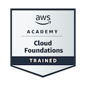
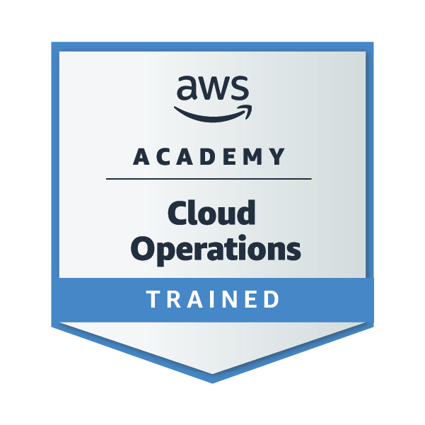
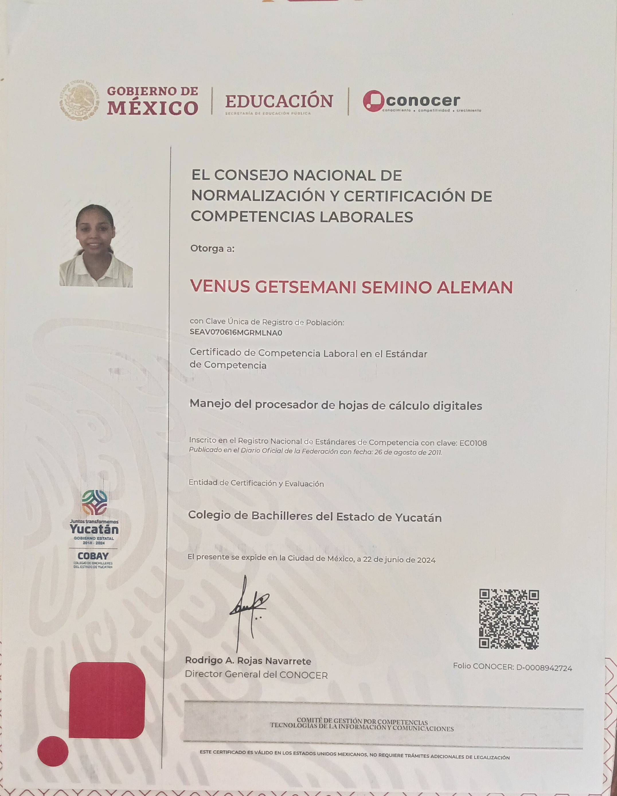

#  Mis Certificaciones

### Portafolio de formación académica y profesional

Bienvenido a mi repositorio de certificaciones, cursos y reconocimientos.

Este espacio reúne las constancias e insignias que he obtenido durante mi formación académica y profesional, reflejando mi interés por el aprendizaje continuo y el desarrollo de habilidades tecnológicas.

---

##  Amazon Web Services (AWS)

### AWS Academy Graduate — Cloud Foundations

**AWS Academy Cloud Foundations**

Formación en fundamentos de computación en la nube, infraestructura, servicios y conceptos esenciales de AWS.

📄 [Ver certificado completo](./AWS_Academy_Graduate___Cloud_Foundations___Training_Badge_Badge20260713-20-tv1mwn.pdf)

---

### AWS Academy Graduate — Cloud Operations

**AWS Academy Cloud Operations**

Formación en administración, monitoreo y operación de recursos e infraestructura en la nube.

📄 [Ver certificado completo](./AWS_Academy_Graduate_CloudOperations_Venus.pdf)

---

### AWS Cloud Practitioner Essentials

Curso introductorio sobre los principales servicios, conceptos y beneficios de Amazon Web Services.

📄 [Ver constancia](./AWS%20Cloud%20Practitioner%20Essentials.pdf)

---

##  Redes y conectividad

### Network Technician Career Path

Formación orientada a fundamentos de redes, conectividad, infraestructura y conocimientos técnicos relacionados con redes informáticas.

📄 [Ver certificado completo](./NetworkTechnicianCareerPathUpdate20260730-20-4ha390.pdf)

---

##  Herramientas digitales

### Microsoft Excel

**Formación en Microsoft Excel**

Conocimientos relacionados con el manejo de hojas de cálculo, organización de información y herramientas para el análisis de datos.

🔎 [Ver certificado en tamaño completo](./certificacion-Excel.jpeg)

---

## 📁 Certificados adicionales

En este repositorio también se encuentra disponible el siguiente documento:

📄 [Consultar certificado adicional](./certificate.pdf)

---

##  Áreas de conocimiento

---

##  Sobre este repositorio

Este repositorio tiene como objetivo documentar mi crecimiento académico y profesional mediante la recopilación de:

-  Certificaciones y constancias de formación.
-  Cursos relacionados con tecnologías en la nube.
-  Formación en redes e infraestructura.
-  Capacitación en herramientas digitales.
-  Reconocimientos y logros académicos.

Continuaré actualizando este espacio conforme adquiera nuevos conocimientos y complete nuevas formaciones.

---

###  El aprendizaje es un proceso continuo

Gracias por visitar mi portafolio de certificaciones.

**Venus Semino**

